  

  
  
  
  

---

Software Engineering undergraduate building **air-gapped RAG engines**, **multi-agent code security pipelines**, and **Turkish NLP tooling**.

- **TEKNOFEST NLP Hackathon:** Ranked **27th / 255 teams (Top 11%)** on Turkish address standardization and `dbmdz/bert-base-turkish-cased` classification.
- **Core Interests:** Hybrid retrieval (BM25 + dense embeddings), cyclic LangGraph workflows, Python AST static analysis, and systems programming in C/C++.

### Selected Projects

<table>
  <tr>
    <td width="50%" valign="top">
      <a href="https://github.com/ensibey/CodeSentinel"><strong>CodeSentinel</strong></a> 
      Hybrid Python AST + 4-agent LangGraph PR security scanner (<code>security_scanner</code> → <code>test_generator</code> → <code>patch_creator</code> → <code>judge</code>) with local CLI and Celery/FastAPI worker.  
      <code>Python</code> <code>LangGraph</code> <code>AST</code> <code>FastAPI</code> <code>Redis</code>
    </td>
    <td width="50%" valign="top">
      <a href="https://github.com/ensibey/PrivaRAG"><strong>PrivaRAG</strong></a> 
      Air-gapped document Q&amp;A engine combining 40/60 BM25 + ChromaDB retrieval, cosine vector semantic caching, and natural-language SQLite/Excel routing via local Ollama.  
      <code>Ollama</code> <code>ChromaDB</code> <code>BM25</code> <code>SQLite</code> <code>Python</code>
    </td>
  </tr>
  <tr>
    <td width="50%" valign="top">
      <a href="https://github.com/ensibey/turkish-nlp-toolkit"><strong>turkish-nlp-toolkit</strong></a> 
      Zero-dependency Turkish text normalizer (<code>İ/I</code> case folding), agglutinative stemmer, postal address parser, CLI, and Turkish BERT fine-tuning wrapper.  
      <code>Python</code> <code>PyTorch</code> <code>Transformers</code> <code>NLP</code>
    </td>
    <td width="50%" valign="top">
      <a href="https://github.com/ensibey/personal-omniscience-engine"><strong>personal-omniscience-engine</strong></a> 
      Local Markdown/PDF knowledge indexer with real-time Watchdog file ingestion, Qdrant vector search, and corpus-driven writing style conditioning.  
      <code>LlamaIndex</code> <code>Qdrant</code> <code>Ollama</code> <code>Watchdog</code>
    </td>
  </tr>
  <tr>
    <td colspan="2" valign="top">
      <a href="https://github.com/ensibey/devtransform-hub"><strong>devtransform-hub</strong></a> · <a href="https://devtransform.org">devtransform.org</a> 
      145+ client-side developer &amp; PDF utilities running completely in-browser via Web Workers with zero server uploads.  
      <code>Next.js</code> <code>TypeScript</code> <code>Web Workers</code> <code>Tailwind CSS</code>
    </td>
  </tr>
</table>

### Stack

| Area | Technologies |
| :--- | :--- |
| **Languages** | `Python` · `C` · `C++ (STL)` · `TypeScript` · `SQL` · `Bash` |
| **AI & Retrieval** | `PyTorch` · `Transformers` · `LangGraph` · `LlamaIndex` · `Qdrant` · `ChromaDB` · `Ollama` |
| **Backend & Tooling** | `FastAPI` · `Celery` · `Redis` · `Docker Compose` · `GitHub Actions` · `Pytest` |
